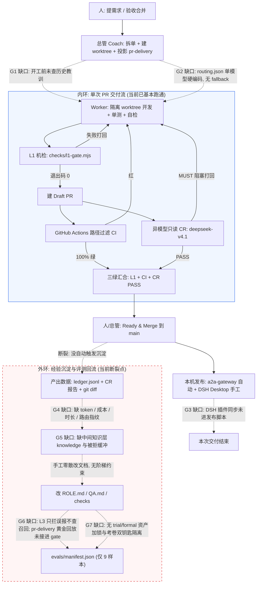
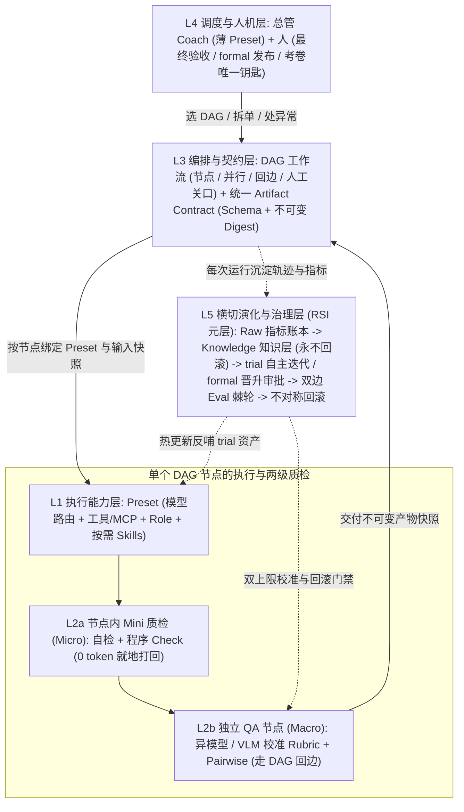
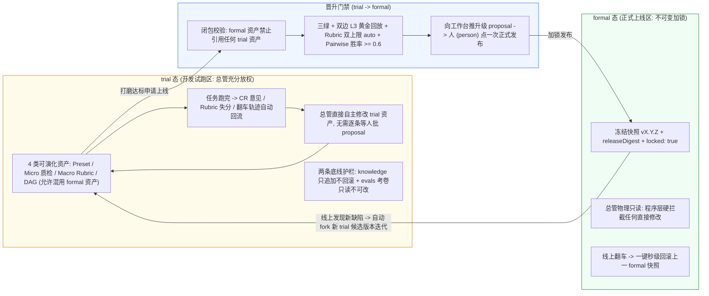
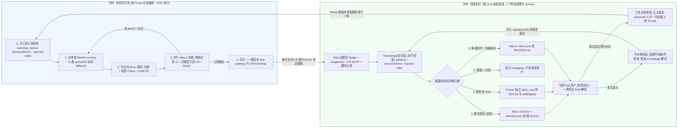
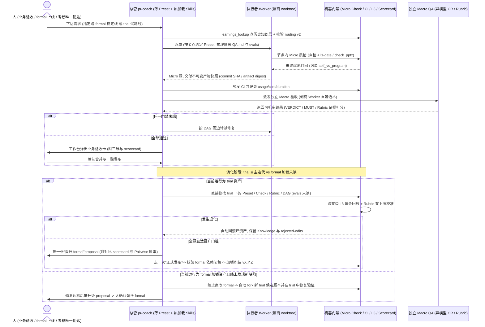
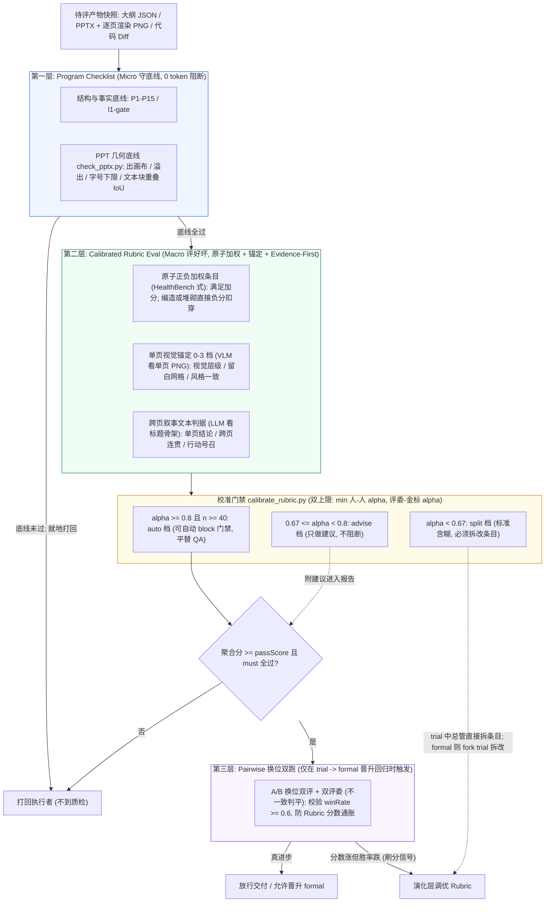

# 业务逻辑全景与缺口地图：5 层模型 × 统一资产 `trial/formal` 双飞轮

> 日期：2026-11-27  
> 关联文档：[5 层概念模型与四路调研综合研判](./compound-agent-architecture-synthesis-20261127.md) · [分阶段 PR 拆分与现有场景演练](./compound-agent-staged-pr-plan-20261127.md)

本文用 6 张可视化流程图 + 1 张落点对照表，完整展示 **AS-IS 现状与缺口（图 1）**、**5 层概念模型（图 2）**、**统一资产 `trial/formal` 生命周期与总管权限边界（图 3）**、**单次交付 × 持续复利双飞轮（图 4）**、**双钥匙治理时序（图 5）**，以及 **Checklist × Rubric × Pairwise 三层质量漏斗（图 6）**。

---

## 图 1：当前真实业务逻辑（AS-IS）与 `G1–G7` 缺口定位

前半段“单次 PR 交付”已经跑通（蓝色实线）；真正断掉的是后半段“经验如何不靠记忆自动变成下一轮的默认能力”（红色虚线与缺口 `G1–G7`；`G8` 见图 6）。

---

## 图 2：补齐承重层后的 5 层概念模型

在“Preset + 质检 + DAG”3 层基础上，显式补出 **统一 Artifact Contract（横向接口）**、**两级质检拆分（Micro vs Macro）**，以及 **总管调度（L4）与横切 RSI 演化治理（L5）**。

---

## 图 3：统一资产 `trial / formal` 双态生命周期与权限边界

Preset、Micro 质检、Macro 质检、DAG 工作流全部作为统一资产纳入 `trial / formal` 管理：**`trial` 对总管充分放权高速迭代，`formal` 不可变加锁防线上漂移，考卷 `evals/` 始终独立只读**。

---

## 图 4：目标业务逻辑（TO-BE）—— 单次交付环 × 持续复利飞轮

---

## 图 5：总管放权与双钥匙治理时序

清晰区分 **`trial` 阶段（总管自主快跑，不烦人）** 与 **`formal` 晋升及考卷变更（人握唯一钥匙，防越权与作弊）**。

---

## 图 6：补齐 `G8` —— 质量评估三层漏斗（Checklist × Rubric × Pairwise）

---

## 8 处缺口 ↔ 代码真实落点对照表

| 编号 | 缺口现象 | 当前代码真实位置 | 为什么卡住“持续复利” | 对应补齐阶段 |
| --- | --- | --- | --- | --- |
| **G1** | 开工前不查历史踩坑 | `.1agents/roles/pr-delivery/workflow.json` 直接从 `implement` 起步 | 同一模块换会话仍会重复踩坑 | Phase 1（PR-1B） |
| **G2** | 单模型硬编码路由 | `.1agents/roles/pr-delivery/routing.json` 写死单一模型 | 额度耗尽 / 429 时全链路卡死 | Phase 3（PR-3B） |
| **G3** | 本机发版 DSH 插件断层 | `scripts/local-deployment.mjs` 只管 `a2a-gateway` | 合并后手工同步 DSH Desktop 易撞旧包 | Phase 0（PR-0A） |
| **G4** | 账本缺成本与稳定性度量 | `packages/service/src/rsi/outline-run.ts` 无 `usage/cost/duration/route` | 无法量化“是否真的更稳、更省” | Phase 1（PR-1A） |
| **G5** | 缺中间知识层与被拒缓冲 | 仅有原始 `ledger.jsonl` 与无 frontmatter 的 `docs/bugs/` | 教训要么膨胀常驻文档，要么回滚即丢失 | Phase 1（PR-1B） |
| **G6** | L3 单边 + 黄金回放未接门禁 | `packages/service/src/rsi/calibrate.ts` 只看 `FP=0`；`gate.ts` 对 `pr-delivery` 报 `ENOENT /cases` | 放宽检查也能过 L3；改坏 `QA.md`/`ROLE.md` 无人拦截 | Phase 1–2（PR-1C / 2A） |
| **G7** | 缺统一 `trial/formal` 资产加锁与双钥匙 | `.1agents/roles/pr-delivery/` 下规则、`checks/` 与 `evals/` 同权同态 | 开发期批不完，生产期锁不住，缺 `formal` 依赖闭包保护 | Phase 3（PR-3A） |
| **G8** | QA 裸 1–5 分制无校准 & PPT 缺多维评测 | `.1agents/roles/product-intro-outline/QA.md`、`.1agents/roles/ppt-beautifier/ROLE.md` | 主观质量抖动、刷分编造可过审、PPT 缺几何与视觉分层评测 | 并行 Rubric 线（PR-R1 / R2 / R3） |
