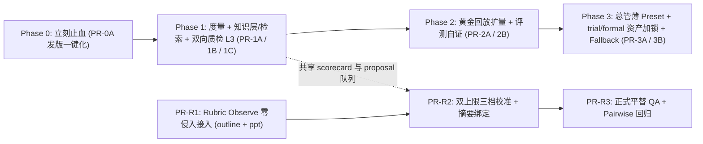

# 分阶段 PR 拆分计划与现有功能演练（5 层模型 `A1–A5` + `trial/formal` 资产设计）

> 日期：2026-11-27  
> 关联文档：[5 层概念模型与四路调研综合研判](./compound-agent-architecture-synthesis-20261127.md) · [业务全景与缺口地图](./compound-agent-business-flow-and-gap-map-20261127.md)  
> **编号约定**：`A1–A5` 指 5 层系统架构层（与个别既有清单条目 id 如 `product-intro-outline` 的 `A1`/`A2` 无关）；`L1 / L2 / L3` 专指本仓既有的三层质检对校体系；PR 编号统一为 `PR-0A` / `PR-1A..1C` / `PR-2A..2B` / `PR-3A..3B` / `PR-R1..R3`。

本文给出：
1. **整套演进的 4 个主阶段 + 1 条 Rubric 并行线的精细 PR 拆分**（每个 PR 独立可回滚、有可机检验收标准）；
2. **以我们已跑过的 3 类真实业务（本仓代码 PR、产品介绍大纲、PPT 美化）为例，在最新 5 层模型 + `trial/formal` 统一资产设计下端到端怎么跑**。

---

## 一、总阶段拆分图（主线 4 阶段 + Rubric 并行线）

> **严格顺序**：先消手工痛点与补度量知识层（Phase 0–1）→ 再夯实双边黄金回放（Phase 2）→ 最后落总管薄 Preset、`trial/formal` 统一资产加锁、双钥匙与弹性路由（Phase 3）。Rubric 评测线利用 `qualityReviewSchema.passthrough()` 与主线解耦，可并行启动观察期。

---

## 二、逐阶段 PR 精细拆分

### Phase 0：立刻止血（消除最高频手工翻车点，解决 `G3`）

| PR | 主题 | 涉及文件 | 验收标准（可机检） |
| --- | --- | --- | --- |
| **PR-0A** | `feat(deploy): support --desktop-profile atomic sync & live CSS check` | `scripts/local-deployment.mjs`、`scripts/local-deployment.test.mjs`、`changelog/` | 1) 按 `packages/service/package.json` 精确版本号定位 `release/1agents-acp-service-<ver>.tgz`（杜绝通配符抓旧包）；2) `--desktop-profile` 原子同步 `.tgz` 与解包目录并保留嵌套 `node_modules`；3) 自动核验 `36814` 与 `3466` `/workbench/ui/app.css` 逐字节一致；4) 单测覆盖缺包/版本不匹配失败回滚。 |

### Phase 1：先看得见 + 先立知识层与开工检索 + 质检 L3 补成双边（解决 `G1 / G4 / G5 / G6`）

| PR | 主题 | 涉及文件 | 验收标准（可机检） |
| --- | --- | --- | --- |
| **PR-1A** | `feat(rsi): run metrics & role scorecard (observe only)` | `packages/service/src/rsi/outline-run.ts`、`packages/service/src/rsi/scorecard.ts`（新）、`packages/service/bin/rsi.ts`、对应单测 | 1) 账本向后兼容增量写入 `route{provider,model}`、`usage{promptTokens,completionTokens,costUsd}`、`durationMs`、`env`、`reworkRounds`；2) `acp-service rsi scorecard --role <dir> --json` 按角色版本 × 路由输出 `firstDraftPassRate`、`pass^k`、`bounces/revisions p50/p90`、`cost p50/p90`；3) 现有 `rsi gate` 行为零变化。 |
| **PR-1B** | `feat(knowledge): docs/solutions, learnings_lookup node, AOCI L1 check & durable ladder` | `docs/solutions/README.md`（新）、`packages/service/src/rsi/compile.ts`（新）、`packages/service/src/rsi/learnings-lookup.ts`（新）、`packages/service/src/rsi/engine.ts`、`packages/service/bin/rsi.ts`、`.1agents/roles/pr-delivery/{workflow.json,checklist.json,checks/l1-gate.mjs}`、`packages/service/skills/rsi-coach/SKILL.md`、`AGENTS.md`（仅在 AOCI 块外加 1 行描述性索引） | 1) 确立统一知识层结构（`module/tags/problem_type/status/source`）与正文只追加不回滚的 `rejected-edits.jsonl`（`stale` 仅改索引元数据）；2) `engine.ts` 新增只读 `learnings_lookup` 节点类型与执行分支（复用 `checklist.ts` 既有条目级 `modePolicy`，不改 `nodeSchema` 严格字段集）；在 `pr-delivery/workflow.json` 中保持 `entry: "implement"` 不破坏 `outline-run.ts` 对 `produce` 节点的识别，改为给 `implement` 声明 `dependsOn: ["learnings_lookup"]` 并交付 `acp-service rsi lookup --paths <files>`；在 `checklist.json` 为其挂 `modePolicy: { trial: "observe", formal: "block" }`；单测跑通 `readRoleRules` + `loadWorkflow` + `runRoundDag`，断言 `implement.dependsOn` 含 `learnings_lookup`、执行序 `learnings_lookup` 严格早于 `implement` 且召回 ≤3 条，并补对称用例验证 `trial` 检索失败不阻断、`formal` 失败 `blocked`；3) `rsi-coach` 写入“最便宜耐久阶梯”（`role`/`qa` 提议须先举证为何写不成 `check`）；4) 在 `checks/l1-gate.mjs` 与 `checklist.json` 新增 `aoci_block_immutable` 程序检查：以基线 `git show $(git merge-base HEAD origin/main):AGENTS.md`（支持 `--base-ref`）对比工作区 `AGENTS.md` 的 `<!-- aoci:begin -->…<!-- aoci:end -->` 字节，反作弊单测须在临时仓库**先提交改动再跑门禁**（提交块内 1 字符改动退出码非 0，仅提交块外索引行退出码 0）。 |
| **PR-1C** | `feat(rsi): bidirectional L3 calibration, check provenance & pr-delivery gate` | `packages/service/src/rsi/calibrate.ts`、`packages/service/src/rsi/checklist.ts`、`packages/service/src/rsi/gate.ts`、对应单测 | 1) `calibration.json` 升 v2：增加 `negativeRecall` 与冻结 `holdout`；放宽检查到什么都不拦必须判 `failed`；2) 新增 `block` 检查必填 `source`，负样本零覆盖时降级 `observe`；3) 修复 `rsi gate --role pr-delivery` 不再报 `ENOENT /cases`，接入 `eval-cr` 与角色目录 digest（改 `ROLE.md`/`QA.md` 同样触发校准）。 |

### Phase 2：把黄金回放做到可信规模（彻底夯实 `G6`）

> **考卷权限说明**：`PR-2A` 与 `PR-2B` 涉及考卷资产（`evals/`），按统一资产权限矩阵须由 **人（`person`）** 审核合入（或通过工作台考卷 `proposal` 由人采纳落地），总管不得自主改写既有考卷。

| PR | 主题 | 涉及文件 | 验收标准（可机检） |
| --- | --- | --- | --- |
| **PR-2A** | `feat(evals): expand pr-delivery golden set to >=20 + case lint & snapshot freeze` | `.1agents/roles/pr-delivery/evals/manifest.json`（人审合入）、`packages/service/src/rsi/pr-cr-eval.ts`、对应单测 | 1) 从已合并 PR #11–#23 补齐样本至 `≥20`（负:正 ≈ 3:2，覆盖 PR #18 租约泄漏、PR #19 失败分类、PR #22 日志/配置降级、PR #23 空列表塌缩）；2) 新增 `--lint` 校验类平衡、缺陷判别力、去重与 `snapshotDigest` 冻结。 |
| **PR-2B** | `feat(evals): judge agreement calibration (kappa) & failure taxonomy` | `packages/service/src/rsi/pr-cr-eval.ts`、`evals/` 人工校准记录（人审合入）、对应单测 | 1) 支持抽样人工标注并计算 Cohen's κ（`κ < 0.8` 时 `promotionReady` 强制 false）；2) 每次 miss 归类（系统设计 / 代理错位 / 任务验证）并可生成 `proposal`。 |

### Phase 3：统一资产 `trial/formal` 加锁 + 总管薄 Preset + 弹性路由（解决 `G2 / G7`）

| PR | 主题 | 涉及文件 | 验收标准（可机检） |
| --- | --- | --- | --- |
| **PR-3A** | `feat(governance): unified trial/formal asset lock, pr-coach preset & two-key gate` | `.1agents/roles/pr-coach/`（新：`profile.json` / `ROLE.md` / `checklist.json` / `skills/{pr-orchestrate,local-deploy-verify,rsi-distill}`）、`packages/service/src/roles/asset-lifecycle.ts`（新）、`packages/service/src/execution/ticket.ts`、`packages/dsh-plugin/src/preset.ts` | 1) 4 类资产（Preset / Micro Check / Macro Rubric / DAG）统一带 `lifecycle: trial \| formal` 与 `digest`；2) 总管对 `trial` 资产充分放权自主修改，对 `formal` 快照与 `evals/` 考卷物理/程序只读（违规写入直接拒绝）；3) **`formal` 单向依赖闭包校验**（`formal` DAG/Preset 引用任意 `trial` 资产直接拒绝晋升）；4) 支持 `formal` 缺陷一键 fork 新 `trial` 候选与一键秒级回滚旧 `formal` 快照；5) `proposal` 收口为考卷/越权/`trial→formal` 晋升三类，必填 `evidence` 且拒绝批量结算。 |
| **PR-3B** | `feat(routing): routing v2 with fallback & canary eval gate` | `.1agents/roles/pr-delivery/routing.json`、`packages/service/src/roles/routing.ts`（新）、`packages/service/src/a2a/gateway.ts`、对应单测 | 1) 支持 `primary + fallbacks[]`（仅在派单边界、按 `quota`/`rate_limit`/429/5xx/超时切换，硬约束 `reviewer` 与实际 `worker` 异模型族）；2) 注入 429 演练 `<60s` 自动切换且同 `jobId` 续跑；3) 修改 `routing.json` 晋升 `formal` 前须过 canary 黄金回放。 |

### 并行线：Rubric 评分 Eval 体系（解决 `G8`，可与 Phase 1 并行启动）

| PR | 主题 | 涉及文件 | 验收标准（可机检） |
| --- | --- | --- | --- |
| **PR-R1** | `feat(rubric): observe-mode rubric.json, rubric_lint & check_pptx` | `.1agents/schemas/rubric.schema.json`（新）、`.1agents/README.md`（登记 `schemas/`）、`.1agents/roles/product-intro-outline/{checklist.json,QA.md,rubric.json（新）,checks/rubric_lint.py（新）}`、`.1agents/roles/ppt-beautifier/{rubric.json（新）,checklist.json（新）,workflow.json（新）,checks/check_pptx.py（新）}` | 1) 零 TypeScript schema 改动（复用 `qualityReviewSchema.passthrough()`）；2) 在 `product-intro-outline/checklist.json` 新增 `P16`（`kind: program`、`runner` 指向 `rubric_lint.py`、`modePolicy.trial: observe`），`rubric_lint.py` 读 `.1agents/schemas/rubric.schema.json` 校验 schema 与锚点/反例/证据必填，反作弊单测断言当前树 `pass` 且缺陷副本 `fail`；3) 为 `ppt-beautifier` 补齐 `workflow.json` + `checklist.json` 挂载 `check_pptx.py`（可经 `loadWorkflow` + `runRoundDag` 承载），`check_pptx.py` 在溢出/越界/7pt 小字/文本块重叠 4 类缺陷稿上 4/4 命中并输出 `CheckResult`；4) 并行观察期积累真实 `rubric` 输出。 |
| **PR-R2** | `feat(rubric): dual-ceiling calibration (kappa/alpha/rho) & digest binding` | `packages/service/src/rsi/rubric.ts`（新）、`packages/service/src/rsi/calibrate.ts`、`packages/service/src/rsi/gate.ts`、`packages/service/bin/rsi.ts` | 1) `rubric.json` 纳入校准摘要；2) `acp-service rsi calibrate --rubric` 输出逐条 κ/α/ρ 与双上限三档判定（`α ≥ 0.8 且 n ≥ 40` → `auto`；`0.67 ≤ α < 0.8` 或 `n < 40 且 α ≥ 0.67` → `advise`；`α < 0.67` → `split`）；3) 仅 `band === 'auto'` 的 `must` 条目允许自动阻断，`advise` 仅建议，`split` 强制提示拆改条目。 |
| **PR-R3** | `feat(rubric): replace holistic QA scoring & add pairwise version regression` | `.1agents/roles/product-intro-outline/QA.md`、`.1agents/roles/ppt-beautifier/{ROLE.md,QA.md（新）}`、`packages/service/src/rsi/pairwise.ts`（新） | 1) `product-intro-outline/QA.md` 正式由 `rubric.json` 驱动，旧 `scores`（`ticket.ts:17` 要求 `int 1..5`）按 `Math.round(clamp(1 + 4 * normalizedScore, 1, 5))` 派生兼容（补边界 `0 / 0.5 / 1` 单测断言 `qualityReviewSchema.parse` 通过）；2) 为 `ppt-beautifier` 新建 `QA.md` 并同步更新 `ROLE.md` 接入拆模态 Rubric 评审；3) `trial → formal` 晋升跑 A/B 换位双评 + 双评委（不一致判平），要求 `winRate ≥ 0.6` 才放行，防 Rubric 刷分通胀。 |

---

## 三、以我们跑过的 3 个真实场景为例：最新设计下怎么做？

### 场景 1：本仓代码研发 PR（对照已跑过的 PR #18 / #22 / #23）

| 环节 | 之前的做法 | 最新设计下的做法（`A1–A5` + `trial/formal`） |
| --- | --- | --- |
| **1. 启动总管（A4）** | 长对话靠上下文记流程，手写 `git worktree` / `roles project` | 选 DSH 薄 Preset **`oneagents-pr-coach`** 开会话 → 自动加载 `pr-coach` 角色与 `pr-orchestrate` / `local-deploy-verify` / `rsi-distill` Skills。 |
| **2. 开工前检索（A5 → A1）** | Worker 盲写，同类坑跨会话复发 | DAG 前置节点 **`learnings_lookup`**（`PR-1B` 交付，`implement.dependsOn` 指向它）在开工前按目标目录检索 `docs/solutions/` 与 `rejected-edits.jsonl`，把 ≤3 条历史约束带入 Worker brief。 |
| **3. 派单与执行（A3 + A1 + A2a）** | `routing.json` 单点硬编码；仅靠人工跑质检 L1 | 按 **`routing v2`** 派单（遇 `quota`/429 在派单边界自动切候选且强保异模型 CR）；Worker 节点内跑 **Micro 质检（A2a）**（自检 + `l1-gate`），不过就地重来，交出不可变 `commit SHA` 快照。 |
| **4. 独立验收与度量（A2b + A5）** | 只有通过/失败，无 token/成本/时长趋势 | 并行跑路径过滤 CI + **Macro 独立只读 CR（A2b）**（剥离 Worker 自辩话术）；账本自动记录 `usage/cost/duration/route/reworkRounds` 更新 `scorecard`。 |
| **5. 合并与本机发布（A4）** | 手工选 `.tgz` 解包 DSH Desktop（曾差点选错旧包） | 人验收合并后一键运行 **`local-deployment.mjs --desktop-profile`**（`PR-0A`）：按 `package.json` 精确版本原子更新 `a2a-gateway` 与 DSH Desktop 并核验 `36814 === 3466`。 |
| **6. 经验沉淀（`trial` 放权 vs `formal` 加锁）** | CR 抓出 MUST 修完就结束，经验留在聊天里 | ① 若在 **`trial` 试跑线**：总管直接按耐久阶梯把 CR 教训写进 `trial` 的 `checks/`、`SKILL.md` 或 `QA.md` 并自动跑双边质检 L3（退化则不对称回滚，保留 `knowledge/`），打磨全绿后向人发一张“晋升 `formal`”`proposal`；② 若在 **`formal` 线上线**：`formal` 资产物理只读加锁，总管自动 **fork 新 `trial` 候选**去自主修复验证，达标后再请你点一次“升级上线 `formal`”。 |

---

### 场景 2：产品介绍大纲（对照已跑过的 `product-intro-outline` 角色）

| 环节 | 之前的做法 | 最新设计下的做法 |
| --- | --- | --- |
| **1. Micro 底线（A2a）** | 宿主跑 P1–P15 程序检查 | 保留 P1–P15 + 新增 `P16 rubric_lint`（`PR-R1`）；新增 `block` 检查必填 `source` provenance，交付不可变 `outline-rN.json` 快照。 |
| **2. Macro Rubric（A2b）** | `QA.md` 6 维 1–5 分制未校准、缺原文证据，刷分编造也能拿 4 分过审 | 改跑 **`rubric.json`（8 条，正 +14 / 负 −6）**：先引 `path:line` 原文证据再判；编造能力直接触发 `R7 (-4)` 拉穿通过线（0.571 < 0.80）。 |
| **3. `trial` 调优与 `formal` 晋升（A5）** | 分数未校准；改完 `ROLE.md`/`QA.md` 靠感觉 | 在 **`trial` 态**总管可自主拆改 `split` 档模糊条目、调整 `ROLE.md` 并并行 observe 攒金标；只有当 `calibrate --rubric` 双上限达 `auto`（`α≥0.8, n≥40`）且 `formal` 晋升前的 **A/B 换位 Pairwise 胜率 ≥ 0.6**，才发一张升级 `proposal` 由人加锁发布为 `formal`。 |

---

### 场景 3：PPT 制作与美化（对照已跑过的 `ppt-beautifier` 角色）

| 环节 | 之前的做法 | 最新设计下的做法 |
| --- | --- | --- |
| **1. Micro 几何底线（A2a）** | OOXML 只查“能否打开”，溢出/重叠/小字靠肉眼看 | 交付 `deck.pptx + rendered/*.png` 快照后，先跑 **`check_pptx.py`**（`PR-R1` 交付，0 token 硬拦 V1 出画布、V2 溢出、V3 字号下限、V4 文本块重叠 `IoU > 0.15`），未过就地重排，不到 VLM。 |
| **2. 拆模态 Macro Rubric（A2b）** | VLM 整套泛泛点评（像素定位与跨页叙事均弱） | 跑 12 条 `rubric.json`：**单页 PNG 给 VLM** 评 V5 层级（0–3 锚定 + 反刷分配对 `V3+V6`）、V6 留白网格、V7 图表、V8 风格及负向 V11/V12；**标题骨架给 LLM** 评 V9 单页结论与 V10 跨页连贯。 |
| **3. `trial` 模板打磨与 `formal` 加锁（A5）** | 改了美化 Skill 不知好坏，改坏直接影响线上出稿 | 线上稳定出稿永远跑已加锁的 **`formal` PPT 资产包**（`formal` DAG 只引用 `formal` Preset + `formal` `check_pptx` + `formal` Rubric）；实验新模板或调 Rubric 时在 **`trial` 态**复用 `formal` 底座做单资产灰度试跑，过双上限校准 + 换位 Pairwise 确认真更好看后，人点一次升级 `formal`（线上遇退化一键秒回滚旧版）。 |

---

## 四、建议的第一批开跑组合（3 个源码文件零重叠的并行小 PR）

本设计基准合入 `main` 后，第一批可直接并行启动以下 3 个**源码文件零重叠**的小 PR（`changelog/YYYY-MM-DD.md` 按合并顺序追加即可）：

1. **`PR-0A`（半天）**：`scripts/local-deployment.mjs` 增加 `--desktop-profile` 精确版本同步与 `36814/3466` 一致性核验。
2. **`PR-1A`（1 天）**：RSI 账本补充 `route/usage/duration/env` + `acp-service rsi scorecard`（observe 模式）。
3. **`PR-R1`（1 天）**：零 TS 改动落地 `product-intro-outline` 与 `ppt-beautifier` 的 observe 期 `rubric.json` + `check_pptx.py` + `rubric_lint.py`。
