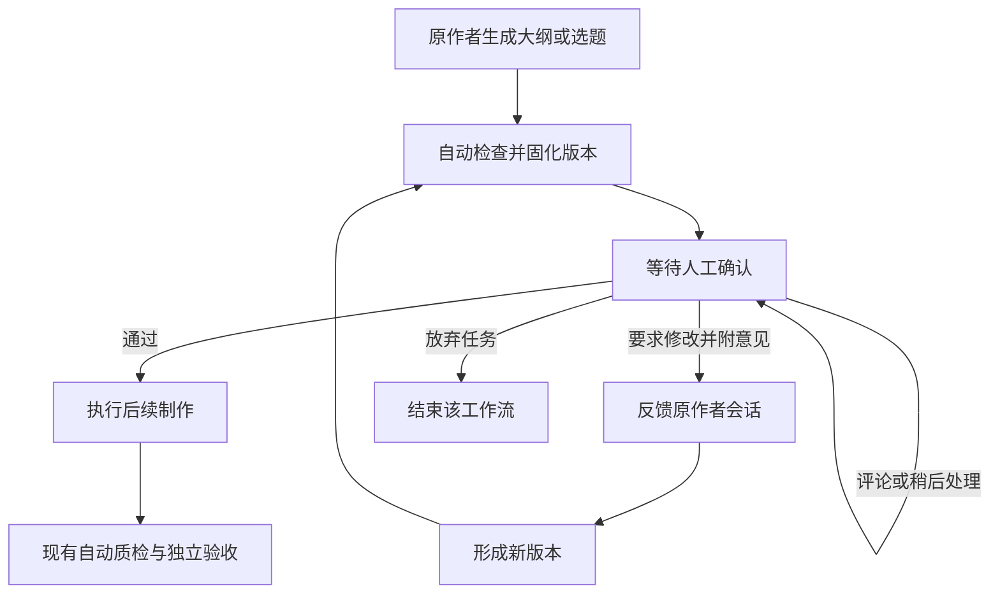

# agent-workflow 人工审核节点与异步确认机制调整思路

- 整理日期：2026-10-22（Asia/Shanghai）
- 状态：首版已实现并完成隔离验证，尚未切换生产服务；见 [实施记录](task-workbench-implementation-20261022.md)。
- 适用范围：先在现有 PPT 交付流程补齐中间阶段人工确认，再用于选题、文稿、视频制作等固定职能。
- 项目目录：`/Users/scott/Documents/01-开发项目/1agents/1agents_app/modules/1acp`

## 一、目标与核心判断

当前 ACP 已经具备常驻服务、任务分派、执行记录、机器或智能体验收，以及把反馈返回执行会话的基础。下一步应让人能够在选题、大纲或文稿形成时介入：查看明确版本的产物，提出修改意见，确认后再由系统自动推进后续阶段。

优先补齐的是一个可以持久等待、接收真实人工决定、可靠续跑的阶段审核机制。首版产品可以由审核详情页、“我的待确认”入口和一个通知渠道组成。统一工作台可以在实际审核量和协作需求出现后逐步扩展。

任务执行完成、人工业务确认、通知已读是三件不同的事。某个子任务完成后，整个工作流仍然可以等待人工确认；等待期间无需让模型持续运行。

## 二、2026-10-22 已确认的现状

本节记录前序通过 DreamMate MCP 对 Mac 节点进行只读检查的结果。运行包为 `@1agents/acp-service` 0.8.1，所在 release 为 `20261021-progress-cancel-01`。以下结论限定于所检查的当前 ACP/PPT 链路。

| 能力 | 已确认的行为 | 对本次调整的意义 |
| --- | --- | --- |
| PPT 大纲阶段 | `validateSummary` 成功后，编排器直接把阶段推进到 `make`。 | 大纲生成之后尚无人工确认关口。 |
| PPT 最终交付 | 收据写入 `humanAcceptance: 'not_requested'`；已观察到的完成记录也是这个值。 | 当前自动交付完成并不以人工业务确认为前置条件。 |
| `execution_review` | 调用账本的 `acceptance`，要求引用已完成的 Attempt，并校验 `resultRevision` 和 `resultDigest`，记录 `pending / accepted / changes_requested`。 | 已有版本绑定的验收记录能力，但当前 PPT 编排器没有消费该记录来阻塞或恢复中间阶段。 |
| `execution_inbox` | 按 `originSessionId` 查询未处理通知。 | 当前是会话维度的通知入口，还不能直接承担按人归属、跨会话汇总的待审核入口。 |
| 人工决定身份 | 所检查的 `BusinessAcceptance` 结构没有独立的人工决策者身份字段。 | 需要把可识别的人工操作及其来源记录下来。 |
| 大纲产物 | 同时生成 `slide-script.md` 和 `slide-script.json`；下游制作读取 JSON，现有摘要校验会冻结脚本 digest。 | 人看到的内容必须与下游实际消费的内容对应；修改后应产生新的可审核版本。 |
| 执行预算 | PPT 默认 `maxDurationMs` 为一小时，当前按创建以来的墙钟时间判断。 | 人工等待时间需要与执行预算分开计算。 |

相邻的 `1agents_app` Go 后端已有 `awaiting_human` 调度状态，前端也有聚合待办界面，可作为复用线索。当前未确认这些能力已接入所检查的 ACP 运行链路。现有 IM 决策代码中的 `reject` 会取消任务，也不等同于本次需要的“带意见退回原作者修改”。

## 三、目标工作流

先把人工关口放在成本较低、方向影响较大的中间产物上。PPT 首选大纲／六页文字稿完成之后、设计制作之前；视频首选选题和文稿形成之后、混剪制作之前。是否发布可以是另一个独立的人工决定。

人工关口只阻塞依赖该决定的后续阶段。其他互不依赖的任务可以继续执行。用户离开主会话、关闭界面或服务重启后，待确认事项仍应存在。

## 四、人工操作的语义

| 操作 | 含义 | 工作流行为 |
| --- | --- | --- |
| 评论 | 对当前内容补充说明或提出问题，尚未作出决定。 | 保持等待，不自动放行。 |
| 要求修改 | 当前版本不能通过，并给出具体修改意见。 | 返回该阶段原作者会话；修订后生成新版本，重新进入待确认。 |
| 通过 | 同意明确展示的这一版内容继续执行。 | 记录人工身份与决定，放行该版本对应的下游阶段。 |
| 稍后处理 | 暂时不作决定。 | 保留待确认状态，可以后续提醒。 |
| 放弃任务 | 明确终止本次工作。 | 取消尚未执行的依赖阶段，并保留已有产物与历史。 |

“要求修改”和“放弃任务”必须分开。“通知已读”不能当作“审核通过”。智能体在会话里声称“用户已同意”，也不能直接替代可核验的人工决定。

批准必须绑定具体产物版本和摘要。内容有变化就需要形成新版本；旧版本的批准不得放行新版本。用户打开旧链接时，应看到该版本已被替代或已有决定，并能跳转到当前待审核版本。

## 五、三项职责分别实现

### 1. 持久化审核请求

审核请求负责保存谁需要确认、确认什么、当前状态及历史决定。它关联现有 Job、Attempt 和阶段，沿用现有任务账本作为执行事实来源。

建议保存以下信息，字段名可在实现时结合现有模型确定：

| 信息 | 用途 |
| --- | --- |
| 审核请求 ID、Job ID、阶段、产物所属 Attempt | 唯一定位审核对象与执行上下文。 |
| 原作者会话、源产物引用 | 将修改意见返回正确的生产者。 |
| 审核人或负责人 | 支持“我的待确认”，校验决定权限。 |
| 产物类型、版本、digest、可读预览 | 让人明确知道自己在确认什么。 |
| 待确认、通过、要求修改、已替代、取消等状态 | 表达审核生命周期；具体枚举在实现时确定。 |
| 评论、决定、操作者、来源、时间 | 支持追溯与后续复盘。 |
| 续跑处理状态或关联事件 | 避免已批准但未推进，或重复推进。 |

此处新增的是关联阶段的审核记录，不另建第二套 Job/Attempt 系统。也不应为了复用旧界面，把任务权威状态搬回另一套任务存储。

### 2. 异步通知

通知负责提醒用户有事项待处理，并提供进入审核详情的入口。聊天、移动端通知或邮件都可以作为投递渠道；首版只需接一个已经可用的渠道。

审核状态以服务端持久化记录为准。通知丢失、重复投递或用户换设备，都不应改变审核决定。若允许直接回复消息作出决定，回复必须能关联到具体审核请求、版本和实际用户。

### 3. 轻量审核界面

首版审核详情页展示标题、完整大纲／文稿、素材依据、版本、修改历史和评论区，提供通过、要求修改、稍后处理和放弃操作。

“我的待确认”按人聚合跨会话事项；原主会话保留状态通知和跳转入口。这样用户不必找到最初发起任务的会话，才能继续处理工作。

手机端 Personal Working Agent 仍可作为长期的主要入口。首版可以先提供适配手机的 Web 审核页，再逐步接入原生入口。

## 六、后端最小调整

### 1. 在编排中增加真正的等待与续跑

在 PPT 大纲结构校验成功后，创建阶段审核请求并持久化等待状态。通过决定写入后，再驱动 `make` 阶段；要求修改则把意见返回大纲生产者。

现有 `execution_review` 主要处理已完成 Attempt 的业务验收。实现中应明确区分阶段审核与最终交付验收，避免仅给现有枚举增加一个值，就声称已经支持中途暂停。

阶段的作者 Attempt 可以已经完成，而父工作流仍然处于等待人工状态。是否复用现有 `input_required` 加等待原因，还是增加内部阶段状态，应按现有状态契约作最小改动。

### 2. 让审核展示和下游输入同源

目前存在 Markdown 和 JSON 两份脚本。应选定规范化的权威内容，审核页由该内容生成可读视图，下游消费同一版本对应的数据。

当前冻结脚本 digest 的逻辑适合保证已确认内容不被悄悄替换。加入人工修改后，应生成新的 revision 和 digest，保留上一版，而不是直接覆盖已经冻结的文件。

### 3. 把修改送回正确的作者

对大纲提出修改，应返回大纲生产者的会话；对设计提出修改，才返回制作智能体。当前 PPT 的 `revise` 主要面向制作阶段，不能直接作为所有人工修改的路由。

继续使用原会话的上下文，并按现有协议创建所需的新执行尝试；不要把一个已完成任务的终态记录直接改写成仍在执行。

### 4. 区分等待预算和执行预算

人工等待不应耗尽模型执行时间预算。分别记录执行消耗与人工等待；若需要审核截止时间、提醒或超时关闭，使用独立策略。

人工修改轮次也应与自动质检失败重试次数分开，避免用户的一次内容意见直接耗尽系统故障重试额度。

### 5. 可靠记录决定并触发后续动作

保存审核决定与触发续跑之间需要可靠衔接，可以复用现有持久化事件或投递机制。实现应保证重复点击、重复通知和服务恢复不会重复启动下游阶段；批准已落盘但续跑尚未完成时，应能恢复推进。

用户身份、目标版本与当前审核状态应在服务端校验。代理会话、机器质检结论和真正的人工操作需要能够区分。

## 七、首版范围与推进顺序

首个业务闭环选 PPT 大纲审核，复用已有制作、自动质检和独立验收链路。

1. 增加阶段审核记录与按人查询待确认事项的能力。
2. 在大纲校验成功处插入等待点，绑定产物版本和摘要。
3. 接入人工通过、评论与要求修改的处理，打通原作者修订和再次审核。
4. 提供一张审核详情页与一个待确认列表入口。
5. 接入一个通知渠道，验证离开主会话后仍能处理。
6. 验证持久化恢复、重复决定、旧版本失效及执行预算，再扩展到视频选题和发布确认。

首版无需同时引入完整邮件系统、跨渠道消息中心、通用可视化流程编辑器或大规模角色权限配置。已有邻近界面和通知组件可以择要复用，具体部署关系需在实现前核实。

## 八、端到端验收标准

| 场景 | 预期结果 |
| --- | --- |
| PPT 大纲形成并通过自动检查 | 出现待人工确认事项，制作阶段尚未启动。 |
| 用户离开主会话后打开审核入口 | 能找到该事项、查看完整内容及明确版本。 |
| 用户只发表评论 | 状态仍为待确认，下游不启动。 |
| 用户要求修改并给出意见 | 意见到达大纲原作者会话；旧版保留，新版进入待确认。 |
| 用户批准新版本 | 下游自动制作，并使用该批准版本对应的脚本。 |
| 用户尝试批准已被替代的旧版本 | 不能放行当前新版本；界面指向最新待审核内容。 |
| 相同决定重复提交 | 只产生一次有效推进，不重复派发制作任务。 |
| 等待时或决定落盘后服务重启 | 状态与决定保留，能恢复到正确节点继续处理。 |
| 人工等待超过当前默认一小时 | 不因等待本身误判模型执行超时。 |
| 后续制作与自动验收 | 继续使用已有链路，并能追溯到批准的大纲版本。 |

业务上完整的验证路径是：大纲生成 → 等待确认 → 用户要求修改 → 原作者修订 → 用户批准新版 → 自动设计 → 现有质量验收。

## 九、证据与实现入口

以下路径用于定位前序检查结论。agent-workflow 内部路径相对本文件所在的 `docs` 目录。

- [PPT 交付编排](../packages/service/src/execution/ppt-delivery.ts)：`validateSummary`、`advancePptDelivery`、`revise`、执行预算和最终收据。
- [任务账本](../packages/service/src/execution/ledger.ts)：`BusinessAcceptance`、`acceptance`、完成状态与版本摘要校验。
- [A2A 网关](../packages/service/src/a2a/gateway.ts)：`execution_review`、`execution_inbox`、`execution_ack` 与现有继续执行入口。
- [进度投影](../packages/service/src/execution/delivery-progress.ts)：阶段和进度展示；它本身不承担调度。
- [单一任务账本既有方案](a2a-job-ledger-plan.md)：后续实现应保持任务事实来源一致。

相邻代码的参考位置位于父仓库 `1agents_app`：

- `backend/internal/agent/scheduler.go`：`awaiting_human` 的调度处理。
- `backend/internal/projectitems/tools.go`：`toolCompleteHumanTask`。
- `backend/internal/agent/notify.go`：IM 决策和当前取消语义。
- `frontend/src/components/personal/PersonalAggregatePanel.tsx`：跨事项聚合界面的复用线索。

前序核对的运行包路径为 `/Users/scott/.local/share/1agents/a2a-gateway/releases/20261021-progress-cancel-01/runtime/node_modules/@1agents/acp-service`；对应编译文件位于 `dist/src/`。运行包、项目源码和相邻前端的部署状态应分别核实。

本次方案已按后续确认扩展为多维任务表格、统一任务详情、血缘关系、阶段进展和人工审核。源码及隔离验证结果见 [实施记录](task-workbench-implementation-20261022.md)；生产启用仍需部署并配置独立工作台连接。
