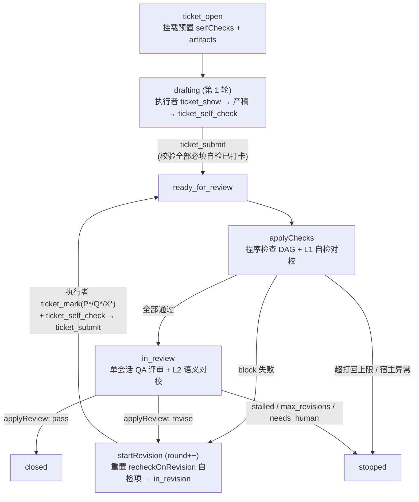
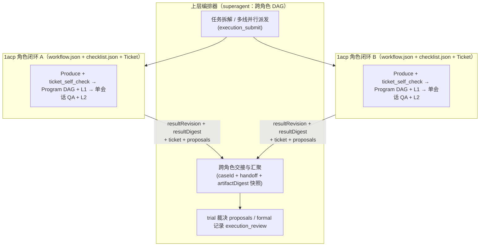

# RSI 清单对校、角色内 Micro-DAG 与 A2A 工作台集中审批设计稿

- 日期：2026-11-25（Asia/Shanghai）。
- 状态：设计稿（待实施）。下文四个部分均为待实现架构与交互方案，不代表当前版本已具备。
- 源码基线：`main` @ `b9348ec5`。
- 适用范围：`@1agents/acp-service`（Ticket、RSI 引擎与网关工作台投影）、`@1agents/dsh-acp`（`oneagents-review` MCP、DSH 工具与侧边栏工作台面板）、`.1agents/roles/` 角色目录规范，以及与上层编排器（`superagent`）的跨角色对接边界。

---

## 0. 背景与核心目标

### 0.1 `trial` 与 `formal` 的业务含义及 `1acp` 闭环映射

在智能体工程中，`trial`（试跑 / 探标）与 `formal`（正式 / 达标交付）不需要两套独立的任务单系统，而是**同一套 `1acp` 任务单与检查对校闭环上的两种执行策略（Policy）**：

| 维度 | `trial`（试跑 / 探标） | `formal`（正式 / 达标交付） |
| --- | --- | --- |
| 核心业务目标 | 标准尚未固化（新角色、新任务类型、新场景）：通过真实样本把隐性标准显性化，找出缺失检查、含糊指令与必须锁给人类的红线 | 标准和检查已收敛：按既定标准稳定生产，不达标即打回，达标才放行 |
| 最关键产出 | 试跑产物 + 对校分歧报告 + 规范改进提议 `proposals`（`check` / `role` / `qa` / `locked`） | 绑定不可变 `resultRevision` + 64 位 SHA256 `resultDigest` 的最终交付物 |
| 检查与评审行为 | 允许 `observe` 级规则只采集证据与提议而不硬阻断；单会话 QA 既审产物，也通过 `proposals` 反向沉淀标准 | 硬闸门：必填自检打卡 → 确定性程序检查全绿 → 单会话 QA 评审（`must` 项清零放行） |
| Coach / 人收口动作 | Coach 裁决 `role`/`qa`/`check` 提议并沉淀版本；涉及 `locked` 红线或角色发布时由人在工作台页面拍板 | 核对产物满足目标与输出契约 → 记录版本绑定业务验收 `execution_review(accepted)` → 经受控 `handoff` 进下游 |
| 对外副作用 | 默认仅内部试跑与评审，禁止外部发布或自动交接 | 验收通过后允许进入正式交付链路；强人工关口仍留给工作台页面 `person` 审批 |

### 0.2 当前实现的主要痛点（对照 `b9348ec5` 复核）

1. **领域硬编码渗漏**：`packages/service/src/execution/ticket.ts` 中的 `Ticket` 写死了 `outline: 'outline.json'`；`packages/service/src/rsi/outline-run.ts` 将工作区准备、Python 检查、QA 复审、打回预算与手写断点续跑耦合在 420 行单一循环内，难以复用到其他角色。
2. **清单声明与执行分裂**：`.1agents/roles/product-intro-outline/checklist.json` 已定义 `type: "program"` 与 `type: "agent"`（`A1`/`A2`），但运行时只跑了 `program`，`A1`/`A2` 完全悬空；同时每新增一条规则都需要人工同步 `checklist.json`、`ROLE.md`、`QA.md` 与检查脚本四处，容易漂移。
3. **自检与对校缺乏结构化契约**：首轮（`drafting`）执行者不触达 Ticket，自检仅靠自然语言提醒；程序检查失败或 QA 发现事实错误时，无法区分是“跳过自检”“误解规则”还是“虚假通过”。新检查规则的历史回放校验也停留在人工手工执行阶段。
4. **工作台缺少 Ticket 可视化与集中审批入口**：`packages/service/src/execution/workbench.ts` 未向前端投影 `ledger.tickets`；工作台页面无法查看自检/机检/QA 对校结果，也无法在页面以 `kind: 'person', via: 'page'` 直接裁决 `locked`/`check` 提议；过程请求、产物审核、交接提议分散在不同页面，缺乏集中审批一级入口和侧边栏未读提醒。

### 0.3 已拍板的架构边界

1. **执行者自检走网关工具门禁**：在 `oneagents-review` MCP（及 DSH 原生工具 / CLI 同源定义）中新增 `ticket_self_check` 工具。清单由 Coach 预置在角色 `checklist.json` 并随开单挂载到 Ticket 上，执行者像会话任务清单一样逐项勾选 `pass`/`na` 并写依据，经网关校验全部必填项完成后才允许 `ticket_submit` 交稿。
2. **L2 语义对校保留在单一 QA 会话内**：避免把评审拆碎导致上下文割裂与重复开销。面对复杂任务，由执行者或上层编排器先拆小、多线并行完成后，再经 `handoff` 汇聚到下一环节。
3. **两级编排清晰分层**：单任务内的 Check-Review Micro-DAG 放在角色目录（`.1agents/roles/<role>/workflow.json`，随 git 版本化并受门禁保护）；跨角色任务拆解、并行与交接编排由上层编排器（`superagent`）负责。
4. **代码类任务采用 Git Worktree 隔离创建与受控合并**：并行执行者或 `trial`/`formal` 任务默认运行在独立 `git worktree`（统一落于 `.1agents/runtime/worktrees/<caseId>/<stage>/`），避免污染主工作区和跨线文件冲突；验收通过后按 `trial`/`formal` 策略执行受控合并与回收。
5. **强人工审批集中收口**：工作台新增独立一级 Tab「待审批（Approvals）」统一收口所有强人工关口，并在 DSH 侧边栏图标上提供实时待审/未读消息指示器。

---

## 第一部分：统一清单契约、`ticket_self_check` 与 L1/L2 对校

### 1.1 单一真相清单（`checklist.json` v2）

把「程序检查清单」「智能体自检清单」「单会话对校项」统一在一个声明式 Schema 中，由运行时自动编译投影给执行者（`ROLE.md` 注入段）、程序检查运行器与 QA（`QA.md` 注入段），彻底消除多处手工同步。

```ts
export type CheckKind = 'program' | 'self' | 'self_and_qa';
export type CheckEnforcement = 'block' | 'observe' | 'skip';

export interface CheckItemSpec {
  id: string;                          // 如 P1, P5, A1, S1
  kind: CheckKind;
  dependsOn?: string[];                // 前置依赖，如 P2..P15 依赖 ['P1']
  severity: 'must' | 'should';
  locked: boolean;                     // 锁定项：只有人可修改，对应 proposals(kind='locked')
  rule: string;                        // 规则描述
  nonGoals?: string[];                 // 刻意不拦的边界条件，防误报，自动注入 QA 与检查说明
  /** kind='program' 且为 true 时，同时挂入执行者交付前自检提醒，形成 L1 自检↔机检对校。 */
  selfCheck?: boolean;
  /** 返工轮（in_revision）是否自动重置该自检项要求重新确认，默认 true。 */
  recheckOnRevision?: boolean;
  evidenceHint?: string;               // 要求执行者/QA 提供的依据说明格式
  runner?: {
    id: string;                        // 检查执行器标识（同一批脚本可共享 runner id）
    cmd: string[];                     // 支持 ${python} / ${work} / ${artifact} 变量插值
    timeoutMs?: number;
  };
  modePolicy?: {
    trial?: CheckEnforcement;          // trial 下可设为 observe（只记证据和提议，不阻断）
    formal?: CheckEnforcement;         // formal 下默认 block
  };
}

export interface ChecklistSpecV2 {
  schemaVersion: 2;
  roleId: string;
  artifacts: string[];                 // 受检主产物相对路径，如 ['outline.json']
  items: CheckItemSpec[];
}
```

三种 `kind` 职责一目了然：
- `program`：宿主运行确定性脚本/规则。若标 `selfCheck: true`，执行者交付前也需确认并记录依据，随后由宿主重跑机检完成 **L1 对校**。
- `self`：Coach 预置的纯执行者交付前自检提醒（类似会话任务列表），强制在交稿前逐项打卡。
- `self_and_qa`：执行者交付前必须打卡写依据，进入单会话 QA 时由 QA 逐项做 **L2 语义对校**。

### 1.2 Ticket 状态机统一：首轮交稿与打回返工闭环合流

在 `packages/service/src/execution/ticket.ts` 中，将当前“首轮不走 Ticket、次轮才走 Ticket”的割裂流程统一为一条状态机：



#### Ticket 数据结构增量（向后兼容 v1）

```ts
export type SelfCheckState = 'pending' | 'pass' | 'na';

export interface TicketSelfCheck {
  id: string;                          // 对应 checklist.json 的 item.id
  kind: 'self' | 'self_and_qa' | 'program';
  severity: 'must' | 'should';
  rule: string;
  evidenceHint?: string;
  recheckOnRevision: boolean;
  state: SelfCheckState;
  checkedInRound?: number;
  note?: string;
  log: TicketLog[];
}

export interface CrossCheckFinding {
  kind: 'self_vs_program' | 'self_vs_qa';
  checkId: string;
  claimedState: SelfCheckState;
  claimedNote?: string;
  actualVerdict: 'fail' | 'disagree';
  actualNote?: string;
}
```

- `Ticket` 新增 `artifacts?: string[]`（保留 `outline?: 'outline.json'` 向后兼容旧账本）和 `selfChecks?: TicketSelfCheck[]`。
- `TicketItem` 新增可选 `crossCheck?: CrossCheckFinding`，用于标注因 L1/L2 对校冲突触发的条目。
- **向后兼容策略**：若开单未传入 `selfChecks`（老角色/历史任务），`selfChecks` 为空，第 1 轮仍允许不调用 `ticket_submit` 直接进入检查；只要角色配置了必填 `selfChecks`，第 1 轮执行者必须完成打卡并调用 `ticket_submit`，否则宿主自动按 `ticketBounce` 打回提醒。

### 1.3 三端同源工具：`ticket_self_check`

`packages/dsh-plugin/src/ticket-spec.ts` 是 DSH 原生工具与 `oneagents-review` MCP 的单一工具定义源（且两者均将 `parameters` 所有字段视为必填），与 `packages/service/src/execution/ticket-executor.ts` 和 `packages/service/bin/ticket.ts` 同步扩展：

```ts
{
  name: 'ticket_self_check',
  description: '把教练预置自检清单上的一项标为 pass（已核验通过）或 na（本任务不适用），并写核验依据。全部必填自检项完成后才允许调用 ticket_submit 交稿。',
  parameters: {
    id: { type: 'string', description: '自检项编号，如 A1、S1、P5。' },
    status: { type: 'string', enum: ['pass', 'na'], description: 'pass：已核验通过；na：本任务不适用。' },
    note: { type: 'string', description: '自检依据（核验了哪些文件、运行了什么检查、或不适用的原因）。' },
  },
}
```

同步配套改动：
- **`ticket_show`**：在 `drafting` 与 `in_revision` 两个阶段均可用，分段输出：
  1. 「预置自检清单（待打卡 N 条 / 已完成 M 条）」；
  2. 「待处理修改意见（P* / Q* / X*，共 K 条）」。
- **`ticket_submit`**：同时校验 `pendingItems(ticket).length === 0` 且必填 `pendingSelfChecks(ticket).length === 0`；未清零时网关直接拒绝并返回具体漏打编号与提示。
- **CLI 回退通道**：`acp-service ticket self-check --job <jobId> --id <id> --status pass|na --note <text>`，与 MCP/DSH 语义完全一致并记录 `via: 'cli'`。
- **台账事件**：每次打卡追加 `ticket.self_checked` 事件（含 `actor: 'executor'`、`round`、`checkId`、`status`、`note`、`attemptId`、`via`）。

### 1.4 L1 与 L2 对校机制

1. **L1 对校（自检回执 ↔ 宿主程序检查）**：
   - 在 `applyChecks(ticket, results)` 中，若检查项 `result.itemId` 未通过，而执行者在同一轮 `selfChecks` 里对该项打了 `pass`，宿主自动在生成的 `P<round>-<itemId>` 上写入 `crossCheck: { kind: 'self_vs_program', claimedState: 'pass', claimedNote, actualVerdict: 'fail' }` 并记录 `ticket.crosscheck_mismatch` 事件。
   - 同时保留并泛化 `D1` 产物字节一致校验（工作目录待检文件 vs 任务产物目录交付文件 `sha256` 必须逐字节相等）。
2. **L2 对校（自检回执 ↔ 单会话 QA 独立复核）**：
   - `qualityReviewSchema` 新增可选字段：
     ```ts
     selfCheckAudit?: {
       id: string;
       verdict: 'agree' | 'disagree';
       note?: string;
     }[];
     ```
   - 单会话 QA 在读到冻结产物与只读 `ticket.json`（含执行者自检依据）后，只需对 `kind: 'self_and_qa'` 的项在 `selfCheckAudit` 中输出核对结论。
   - `applyReview` 合并时：
     - `verdict === 'agree'` → 记入该自检项的核验日志；
     - `verdict === 'disagree'` → 自动生成高优先级修改项 `X<round>-<id>`（`severity: 'must'`，`crossCheck: { kind: 'self_vs_qa', ... }`），把执行者自称的依据与 QA 反证并排呈现，避免泛泛而谈。

---

## 第二部分：角色内 Micro-DAG（`workflow.json`）与跨角色编排边界

### 2.1 角色目录结构（全版本化）

```text
.1agents/roles/<role-id>/
├── profile.json          # 角色 ID、训练层、执行器约束
├── ROLE.md               # 执行方法论（运行时自动拼接 checklist.json 的自检/规则段）
├── QA.md                 # 质检评分与复审规范（运行时自动拼接程序已查项与 L2 对校项）
├── checklist.json        # 单一真相清单（v2）
├── workflow.json         # 单角色内 Check-Review Micro-DAG 与 trial/formal Policy
├── checks/               # 锁定：确定性程序检查脚本与 schema
└── cases/<case-id>/      # 锁定：开发原题与测试变体题用例
```

所有文件随角色目录一起 git 版本化；[gate.ts](file:///Users/scott/Documents/01-开发项目/1agents/network/1acp/packages/service/src/rsi/gate.ts) 继续以角色目录的 git commit 为版本锚点，任何改动（包括修改 `workflow.json` 或 `checklist.json`）都会重置该版本的门禁计数。

### 2.2 `workflow.json` 声明式规范

```json
{
  "schemaVersion": 1,
  "entry": "produce",
  "nodes": [
    { "id": "produce", "type": "executor_turn", "requireTicketSubmit": true },
    { "id": "check_schema", "type": "program_check", "checks": ["P1"] },
    { "id": "check_rules", "type": "program_check", "checks": ["P2..P15"], "dependsOn": ["check_schema"] },
    { "id": "check_digest", "type": "artifact_digest_check", "dependsOn": ["check_schema"] },
    { "id": "l1_crosscheck", "type": "ticket_apply_checks", "dependsOn": ["check_rules", "check_digest"] },
    { "id": "qa_review", "type": "qa_session_review", "dependsOn": ["l1_crosscheck"], "when": "checks_passed" },
    { "id": "l2_crosscheck", "type": "ticket_apply_review", "dependsOn": ["qa_review"] }
  ],
  "cycles": {
    "programBounce": { "from": "l1_crosscheck", "to": "produce", "when": "block_failed" },
    "qaRevise": { "from": "l2_crosscheck", "to": "produce", "when": "verdict_revise" }
  },
  "policies": {
    "trial": {
      "maxProgramBounces": 1,
      "maxQaRevisions": 3,
      "enforceObserveAsBlock": false,
      "requireQa": true,
      "collectProposals": true,
      "allowExternalHandoff": false
    },
    "formal": {
      "maxProgramBounces": 2,
      "maxQaRevisions": 2,
      "enforceObserveAsBlock": true,
      "requireQa": true,
      "collectProposals": false,
      "allowExternalHandoff": true
    }
  }
}
```

### 2.3 通用执行引擎 `packages/service/src/rsi/engine.ts`

将当前 `outline-run.ts` 拆解为「通用 Micro-DAG 引擎 + 薄角色适配器」：

1. **拓扑并发与依赖短路**：
   - 同层无未满足 `dependsOn` 的节点使用 `Promise.all` 并行执行（例如多个检查脚本与 `artifact_digest_check` 并行）。
   - 前置节点失败（如 `check_schema` 未通过），所有下游依赖节点自动标记 `skipped` 并写入明确原因，无需在业务脚本内手写跳过逻辑。
2. **节点级幂等续跑（替代脆弱手工恢复分支）**：
   - 工作目录持久化 `run-state.json`，记录每个已完成节点的 `(round, nodeId, inputDigest) -> { status, startedAt, finishedAt, output }`。
   - `--resume` 恢复时不再猜测 `resumingReview` / `excusedRound`，只需按拓扑序重放当前轮的 DAG：凡命中 `(round, nodeId, inputDigest)` 且状态为 `completed` 的节点直接复用缓存结果，从中断节点无缝续跑。
3. **受控回路与收敛保护**：
   - 仅允许 `cycles` 中声明的两类有界回边（`programBounce`、`qaRevise`），叠加 `stalled()` 收敛判定（同一问题连续两轮未改到位或总分连续两轮未上升即停）与 `needs_human` 判定（卡在 `locked` 提议时停止并升级给人）。
4. **`outline-run.ts` 瘦身**：
   - 仅保留大纲角色特有的工作区准备（`git archive` 导出固定 commit、剔除 `exclude` 目录、校验 `features.json`），其余全权委托给 `RsiEngine`。

### 2.4 与上层编排器（`superagent`）的职责边界



- **角色内黑盒自治**：`superagent` 不关心某个角色内部有几个检查脚本、是否用 Python/Node，只通过统一契约传入 `mode: 'trial' | 'formal'` 与输入参数，收回结构化交付包 `{ jobId, attemptId, resultRevision, resultDigest, ticket, crossCheckSummary, proposals }`。
- **跨角色仍守台账边界**：角色间流转继续走 `1acp` 的 `caseId`、`handoff_propose`、`handoff_decide` 与冻结快照；强人类关口永远留在工作台页面由人确认，不绕过 `resultDigest` 绑定。

### 2.5 Worktree 隔离创建、验收与受控合并生命周期

对于涉及代码仓修改的角色任务（以及 `superagent` 跨角色多线并行拆解），直接共享同一工作目录会导致索引冲突、脏文件串扰与无法安全回滚。将 **Git Worktree 生命周期**纳入 `workflow.json` 与编排契约：

```json
{
  "workspace": {
    "strategy": "git_worktree",
    "root": ".1agents/runtime/worktrees",
    "baseBranch": "feat/rsi-checklist-dag-workbench",
    "branchTemplate": "rsi/${caseId}/${stage}",
    "dependencySetup": "pnpm_offline",
    "mergePolicy": {
      "trial": "keep_isolated",
      "formal": "ff_or_merge_on_accepted"
    },
    "cleanupOnMerge": true
  }
}
```

#### 四阶段标准生命周期

1. **创建（Create & Provision）**：
   - 在派发执行者前，宿主/编排器从指定的 `baseBranch`（或固定 `baseCommit`）创建独立工作树：
     `git worktree add -b <branch> .1agents/runtime/worktrees/<caseId>/<stage> <baseRef>`；
   - 按项目声明完成依赖就绪（如 Node/pnpm 仓库执行离线锁文件安装或共享缓存链接），保证执行者在工作树内可直接运行 `typecheck` 与单测；
   - 将 `{ worktreePath, branch, baseCommit }` 写入任务元数据与台账事件（`worktree.created`），执行者 `cwd` 严格锁定在该工作树内。
2. **执行与版本绑定（Execute & Digest）**：
   - 执行者在同一 worktree 中完成修改、自检打卡（`ticket_self_check`）与提交；
   - 宿主验收与 `execution_review` 绑定该 worktree 的 **`headCommit`（或 patch/tree SHA256）**，防止验收后又被静默改写。
3. **受控合并（Merge Gate）**：
   - **`trial` 模式（`keep_isolated`）**：默认**不自动合入目标分支**，保留分支与 diff 供 Coach/人复盘及提炼 `proposals`，确认无用后一键销毁；
   - **`formal` 模式（`ff_or_merge_on_accepted`）**：仅在程序检查全绿、Ticket `closed` 且 `execution_review(accepted)`（以及必要时工作台人工确认）通过后，才执行合并：
     - 目标分支未前进：优先 `--ff-only` 快进合入；
     - 目标分支已有其他并行分支先合入：先在 worktree 内 `rebase` 或 `merge <baseBranch>`，**合并后再强制重跑一次程序检查（Post-Merge Check）**；若出现冲突或测试失败，立即中止合并、不污染目标分支，把冲突上下文打回执行者会话或升级给人处理。
   - 合并成功后记录 `worktree.merged` 台账事件（含 `sourceCommit`、`targetBranch`、`mergedCommit`）。
4. **回收（Cleanup）**：
   - 合并完成或任务取消/试跑丢弃后，执行 `git worktree remove` 与分支清理（`trial` 失败样本可按保留策略延迟回收，供 L3 复盘），并记录 `worktree.removed`。

> 与跨角色并行 DAG 的协同：当 `superagent` 将复杂任务拆成多条并行子任务时，每条子任务各自拥有独立 worktree 分支；全部验收后由编排器按依赖拓扑逐个做 Merge Gate 合入集成分支（每合入一条重跑一次集成检查），再将集成后的快照 `handoff` 给下游环节。

---

## 第三部分：L3 规则回放对校（`rsi calibrate`）与门禁联动

当 Coach 在 `trial` 中采纳一条 `proposal(kind='check')` 并新增或修改程序检查后，需要验证“新规则真能拦住过去漏掉的错，且不会把过去已验收的好稿误杀”。将 `rsi-coach/SKILL.md` 中的手工回放升级为代码级对校算子：

### 3.1 `packages/service/src/rsi/calibrate.ts` 与 CLI 入口

```sh
acp-service rsi calibrate --role .1agents/roles/<role-id> --workspace .1agents/runtime/rsi [--only P15]
```

核心执行逻辑：
1. 读取 `<workspace>/<role-id>/ledger.jsonl` 中的历史运行记录，自动分桶提取两类回放样本：
   - **正样本（历史通过集）**：历史验收/QA 通过的最终产物快照（如 `reviews/*-rN.json`）；
   - **负样本（历史缺陷集）**：历史被 QA 打回的中间轮次产物快照（附带当时 QA 的 `issues` 与 `proposals`）。
2. 在隔离只读模式下，用当前角色目录的 `checklist.json` 与 `checks/` 逐一跑完所有样本，输出结构化回放报告 `calibration.json`：
   - **误报率（False Positives）**：历史正样本上触发 `block` 失败的条数与明细（**硬红线：必须为 0**，除非人在回放说明中显式声明旧样本标准已废弃）；
   - **召回清单（Caught Historical Issues）**：新规则在哪些历史负样本上提前拦住了过去只能靠 QA 抓出的问题；
   - **版本指纹**：绑定当前角色目录的 `role.commit` 与 `checks/` 内容摘要。

### 3.2 与 `gate.ts` 门禁联动（`trial → formal` 准出标准）

在 [gate.ts](file:///Users/scott/Documents/01-开发项目/1agents/network/1acp/packages/service/src/rsi/gate.ts) 的 `checkGate()` 中新增两项检查，形成完整的准出闭环：

1. **已有门禁条件（保持）**：
   - 角色目录无未提交改动（`!role.dirty`）；
   - 当前版本在开发原题上连续通过 `required` 次（默认 2 次）；
   - 每次初稿均一次通过程序检查（`firstDraftPassed`）；
   - 无未核实 `must` 项；
   - 所有 `check` / `locked` 提议已裁决。
2. **新增门禁条件**：
   - **L1/L2 对校健康度**：连续达标轮次中无未解释的 L1 虚假自检冲突（`self_vs_program` 必须为 0）；
   - **L3 回放校准通过**：若当前版本的 `checks/` 相对上一已发布版本有变更，必须存在绑定当前 `role.commit` 且历史正样本 **0 误报** 的 `calibration.json` 报告。

---

## 第四部分：A2A 工作台前端交互改造与侧边栏集中审批

工作台前端继续保持轻量技术栈（Preact + 原生轻量 SVG，不引入重型画布依赖），且**不另起第二套状态源**，全部从本机 A2A 网关台账与角色目录实时投影。

### 4.1 顶层导航重构：新增独立一级 Tab「待审批」

将 [main.tsx](file:///Users/scott/Documents/01-开发项目/1agents/network/1acp/packages/service/workbench-ui/src/main.tsx#L72) 现有的 3 个一级模块扩展为 4 个，并将**「待审批」置顶首位**，自带实时待处理数字胶囊：

```text
┌─────────────────────────────────────────────────────────────────────────┐
│  任务工作台    [ 待审批  5 ]   [ 事情 ]   [ 任务 ]   [ 智能体 ]   [刷新] │
└─────────────────────────────────────────────────────────────────────────┘
```

- 当用户从 DSH 侧边栏点击进入工作台、当前没有显式 hash 路由且 `pendingCount > 0` 时，默认直接落到「待审批」Tab；若 `pendingCount === 0`，默认落到「事情」Tab。

### 4.2 「待审批（Approvals）」一级 Tab（`ApprovalsModule.tsx`）

将分散在任务详情、事情收件箱和 CLI 中的全部强人工关口收口到一个**“连批流”左右分栏工作台**：

#### 纳管的 4 类强人工审批项

| 审批类型 | 数据来源 | 展示摘要 | 右侧就地审批动作 |
| --- | --- | --- | --- |
| **过程请求** (`process_request`) | `ProcessRequest(pending)` | 工具权限 / 计划内容 / 提问内容 + 剩余截止时间 | 批准 / 拒绝（可勾选终止任务）/ 填写回答 |
| **产物审核** (`review`) | `HumanReviewRequest(pending)` | 产物标题 + `revision` + `digest` 前 12 位 | 右侧内嵌产物预览 → 通过 / 要求修改 / 评论 / 放弃 |
| **交接提议** (`handoff`) | `Handoff(proposed)` | 来源任务 → 目标角色 + 理由 + 冻结快照列表 | 预览冻结快照 → 接受这一版 / 拒绝 |
| **规范提议** (`proposal`) | `TicketProposal(open)`（聚焦 `locked` 与需人确认的 `check`） | 提议类别（`locked` 红标 / `check` 蓝标）+ 规则文本 + 所属角色/任务 | 采纳 / 拒绝 / 已完成 + 理由（网关背书 `kind: 'person', via: 'page'`） |

#### 交互细节
- **筛选与排序**：
  - 顶部双维筛选：类型（`全部 / 过程请求 / 产物审核 / 交接提议 / 规范提议`）+ 渠道（`全部 / 正式 / 试跑`），方便优先清空线上正式阻塞项，或集中处理试跑立标提议。
  - 默认优先级排序：`过程请求（阻塞执行中）` > `产物审核` > `交接提议` > `规范提议`，同类按等待时长降序；快超时项红色高亮。
- **未读 vs 待办双语义**：
  - 每条未展开看过的新审批项左侧带**未读蓝点**；点击展开右侧详情后即消除未读蓝点，但**仍留在待审队列直到真正完成审批动作**，防止点看一眼后遗忘。
- **连续审批流**：
  - 每次提交审批成功后，自动从队列移除该条并选中下一条，实现零跳转连续清零；
  - 遇到 409（版本/状态已被并发变更）时沿用现有冲突提示并自动刷新当前项；
  - 右侧顶部始终提供「打开所属任务 / 所属事情」跳转链接，需要查完整对话或事件时一键直达。

### 4.3 DSH 侧边栏未读 / 待审指示器（`workbench-panel.js`）

改造 [workbench-panel.js](file:///Users/scott/Documents/01-开发项目/1agents/network/1acp/packages/dsh-plugin/src/workbench-panel.js#L18-L67) 中挂载到 `sidebar.panellist` 的 `WorkbenchIcon` 组件，让用户在任意对话界面都能第一时间感知审批卡点：

1. **视觉呈现**：
   - 在 `WorkbenchIcon` 右上角叠加角标：
     - `pendingCount === 0`：不显示角标；
     - `pendingCount > 0`：显示红底白字数字徽章（`1..99`，超过 99 显示 `99+`）；
     - 若 `unreadCount > 0`（存在比用户上次查看更新的审批项）：附带高对比呼吸/强调态，鼠标悬停 tooltip 显示分层摘要（如：`A2A 工作台 · 5 条待审批（2 条新：1 过程请求，1 规范红线）`）。
2. **双轨同步机制（低开销 + 毫秒级消红点）**：
   - **后台轻轮询**：侧边栏挂载后，每 10 秒请求一次轻量接口 `GET /workbench/ui/api/approvals?summary=1`（页面 `document.hidden` 时暂停轮询，切回可见时立即补查一次）；
   - **iframe 实时回传**：工作台页面每次审批动作完成或轮询刷新时，通过同源 `window.parent.postMessage({ type: '1agents:approvals-state', pendingCount, unreadCount, byKind }, location.origin)` 通知宿主侧边栏，审批完一条角标立即减 1，零延迟。

### 4.4 「任务（Tasks）」模块改造（`TaskDetail.tsx` & `main.tsx`）

1. **任务列表行摘要**：挂有 Ticket 的任务在状态/阶段列显示紧凑三灯胶囊（如 `R2 · 自检 4/4 ✓ · 机检 14/15 ✗ · QA 待审`），有 L1/L2 分歧时标橙色 `分歧 N`；使用独立 git worktree 执行的任务同时展示分支名与合并态（`隔离中 / 已合入 / 冲突待解`）。
2. **新增 Tab「任务单与对校（Ticket）」**（置于 `概览` 之后，带未处理数角标）：
   - 顶部轮次切换（`全部 / 第 1 轮 / 第 2 轮 ...`）；
   - **自检清单卡**：展示 Coach 预置的自检项、打卡状态（`pass`/`na`/`pending`）与执行者依据；若命中 **L1（自检↔机检）** 或 **L2（自检↔QA）** 冲突，同行直接展开红色/橙色对照卡（左侧执行者声明、右侧机检证据或 QA 反证）；
   - **程序检查卡**：按 `workflow.json` 依赖分组展示 `P*` 状态与证据（`skipped` 项清晰标出前置失败项），点击产物路径直接拉起 `ArtifactDrawer` 预览；
   - **QA 评审与修改项卡**：展示每轮评分曲线、`Q*`/`X*` 意见、执行者 `done/disputed` 回复与 QA `previous` 复审结论；
   - **改进提议卡（Proposals）**：按 `locked` / `check` / `role` / `qa` 分类，支持页面直接裁决（`采纳 / 拒绝 / 已完成`）并清晰区分决定人身份（`人（网关页面）` vs `教练`）。
3. **升级 Tab「进展（Progress）」**：
   - 当任务关联 `workflowRun` 时，用轻量 SVG 渲染单角色 `workflow.json` 的 **Micro-DAG**：展示并行检查节点、依赖连线、节点状态（含 `cached` 续跑复用标）、以及两条受控回边的预算消耗（`程序打回 1/2`、`QA 返工 1/3`）；老 PPT 交付任务继续兼容展示原线性阶段。

### 4.5 「事情（Cases）」模块改造（`CaseModule.tsx`）

1. **顶部「跨角色流转图（Case DAG）」画布（轻量 SVG，只读投影台账）**：
   - 节点 = Case 下的各角色任务（带 `试跑/正式` 徽章、任务状态、自检/机检/QA 三灯摘要，以及尚未触发的 `conventions` 挂载标签）；
   - 连线 = `edges`（`taken` 实线、`proposed` 虚线，标注 `revision` 与 `digest` 前 8 位）；
   - 支持同层多线并行排布与多前置汇聚，点击节点跳任务详情，点击虚线交接边直接展开冻结快照与审批操作。
2. **事情收件箱与全局「待审批」同源**：
   - 复用同一套审批投影函数，把本 Case 的 `proposal` 纳入收件箱；
   - 修复现有 [CaseModule.tsx](file:///Users/scott/Documents/01-开发项目/1agents/network/1acp/packages/service/workbench-ui/src/CaseModule.tsx#L189) 点击「去处理」未跳转到对应任务/审核面板的问题。

### 4.6 「智能体（Agents）」模块改造（`AgentModule.tsx`）

当选中的草稿或发布记录绑定了 `roleId` 时，在详情区增加 **「RSI 标准与门禁」** 面板：
- **角色版本指纹**：当前 git commit + 是否存在未提交改动（`dirty` 醒目提示）；
- **只读规范预览**：切换查看 `checklist.json`（标明 `self`/`program`/`self_and_qa` 与 🔒 锁定项）、`workflow.json`（Micro-DAG 预览）及 `trial` vs `formal` 策略对照表；
- **门禁状态卡**：直连 `checkGate()` 与 L3 `calibrate` 结果（连续试跑通过进度、初稿机检通过率、L1/L2 分歧数、未裁决 `check/locked` 提议一键跳转、历史样本 0 误报状态、变体题测试结果）；
- **发布前门禁提醒**：从「开发中（trial）」点击「发布」到「已上线（formal）」时，展示门禁检查清单（全绿放行提示；未全绿则明示缺口，仍保留人工最终拍板权）。

### 4.7 后端投影与 API 增量清单

| 位置 / 路由 | 变更性质 | 职责与安全边界 |
| --- | --- | --- |
| `packages/service/src/execution/workbench.ts` | 扩展只读投影 | `AcpTaskSummary` 新增 `ticketSummary`；`AcpTaskDetail` 新增 `ticket`、`workflowRun` |
| `packages/service/src/execution/approvals-view.ts`（新） | 新增只读聚合 | 统一投影 4 类待审批项，同时供全局「待审批」Tab、侧边栏角标与 `case-view.ts` 复用 |
| `GET /workbench/approvals`（含 `?summary=1`） | 新增只读路由 | 返回 `{ totalPending, counts, latestCreatedAt, items? }`；同源浏览器与 Bearer API 均可读 |
| `GET /workbench/roles/:roleId/rsi` | 新增只读路由 | 返回角色 `checklist.json`、`workflow.json`、`checkGate()` 与最近 `calibration.json` |
| `POST /workbench/tasks/:jobId/ticket/proposals/:proposalId` | 新增页面写路由 | 加入 `PAGE_ONLY_ROUTES` 与同源浏览器校验，强制写入 `by: { kind: 'person', via: 'page' }`，绝不允许智能体冒充人 |

---

## 第五部分：分阶段实施路线与验收标准

按四个独立可测、向后兼容的 PR 逐步落地：

1. **PR 1：Ticket 泛化、`ticket_self_check` 三端闭环与 L1/L2 对校**
   - 改动：`ticket.ts`、`ticket-executor.ts`、`bin/ticket.ts`、`dsh-plugin/src/ticket-spec.ts`、`dsh-plugin/src/ticket-tools.ts`、`dsh-plugin/src/review-mcp.ts`。
   - 验收：无 `selfChecks` 的老任务单测全部保持绿灯；新增首轮自检未打卡拒绝提交、打卡后放行、L1 自检↔机检冲突标记、L2 单会话 QA `selfCheckAudit` 分歧生成 `X*` 项等单测。
2. **PR 2：`checklist.json` v2、`workflow.json` Micro-DAG 引擎、Worktree 生命周期与角色适配**
   - 改动：新增 `rsi/checklist.ts`、`rsi/engine.ts`、`rsi/worktree.ts`（封装 worktree 创建、依赖准备、受控合并校验与回收）；为 `.1agents/roles/product-intro-outline/` 升级 `checklist.json` 与 `workflow.json`；`outline-run.ts` 瘦身为薄适配器。
   - 验收：支持 `trial`/`formal` Policy 切换、前置失败依赖短路、并行检查、基于 `(round, nodeId, inputDigest)` 的 `--resume` 断点续跑、worktree 隔离创建与合并冲突保护单测，`rsi-outline-run.test.ts` 全通过。
3. **PR 3：L3 规则回放对校（`rsi calibrate`）与 `gate.ts` 门禁联动**
   - 改动：新增 `rsi/calibrate.ts`、扩展 `bin/rsi.ts` 与 `rsi/gate.ts`，同步更新 `skills/rsi-coach/SKILL.md`。
   - 验收：用历史正负样本验证 0 误报放行与误报阻断，`rsi gate` 正确拦截未校准或存在未解 L1 冲突的版本。
4. **PR 4：A2A 工作台前端升级与 DSH 侧边栏审批指示器**
   - 改动：`workbench.ts`、`approvals-view.ts`、`case-view.ts`、网关路由；`workbench-ui`（`main.tsx`、`ApprovalsModule.tsx`、`TaskDetail.tsx`、`CaseModule.tsx`、`AgentModule.tsx`）；`dsh-plugin/src/workbench-panel.js`。
   - 验收：
     - 顶层 4 Tab 切换正常，「待审批」连批流可就地处理全部 4 类审批，且 `proposal` 写路由拒绝非同源/Agent 请求；
     - DSH 侧边栏图标实时显示 `pendingCount` 与未读态，页面审批后角标即时同步更新；
     - 任务详情可完整查看自检清单、L1/L2 分歧对照与 Micro-DAG；事情模块渲染跨角色流转 SVG 图；智能体模块展示门禁与发布提醒。
