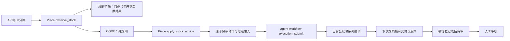

# AP 公众号候补内容补库

宿主重启导致任务失败时，显式停止专用桥接后，执行 `node recover-interrupted.mjs <私密配置> prepare <全部失败原动作键...>`：只核对原失败身份与中断原因，备份已有根目录产物并冻结断点清单及续跑请求，不调用模型。开发部署完成后单独执行同命令的 `submit` 阶段，通过 `execution_continue` 沿用原 Job、上下文、技能锁及输出目录，只补缺项；每次续跑新增 Attempt/Task，旧回执不改写。全部恢复占位与幂等请求在首条发送前落盘，响应丢失由后台重放同一请求，不新建替代 Job。保存受理回执后启动专用桥接，恢复最多3并发与逐篇补位；真实业务/交付异常仍暂停。

状态同步修复：过期/受理未决的原任务保留全部占位，暂时阻止新增制作，但由后台继续查询并自动恢复；仅自动解除“任务受理或状态待核对”这一旧同步暂停，不解除人工审核、交付失败等业务暂停。专用服务同时提供 `127.0.0.1:36816` 本机控制入口，复用同一密钥、租约和状态，避免本机控制依赖Tailnet路由；预览地址保持原Tailnet入口。

最新指令已取消30分钟等待：启用 `policy.continuous=true`、`checkIntervalMs=5000`，由专用后台服务持续核对、保持3个在途位置。每轮优先处理一篇完成交付并补位，不等待其他制作结束；已制作篇目继续复用，清单结束自动停止。原AP定时流程停用以避免重复调度。用户登录服务重启后按持久启动标记恢复。

连续模式部署完成后，使用专用密钥对 `POST /run` 发送JSON即可立即启动，响应仅包含本轮派单回执，不等待模型完成。重复启动复用当前周期；`policy.paused=true` 阻止新增制作。旧库存模式仍要求至少30分钟，只有显式连续批量模式允许5秒检查。

2026-10-23 最新运行方式为 `policy.mode=catalog_batch`、`maxConcurrent=3`：取消10/15库存阈值，按冻结清单顺序把剩余篇目全部制作。已完成和已有在途保留原动作身份，待审核数量不阻止新制作；每次AP检查补齐最多3个在途，清单全部制作交付后结束。沿用每30分钟的AP检查与持久观察间隔，成品人工审核保持。下文库存规则仍作为兼容模式保留。

AP 每 30 分钟读取真实飞书工作台，执行固定条件流程：可发布库存少于 10 篇启动，逐篇补到 15 篇；待审和在途占位，最多一个在途制作。公众号暂留空，使用独立的候补内容池。已定稿报告按原文直接封装，成品必须人工审核。

[角色声明](../../../.1agents/roles/wechat-stock-replenisher/ROLE.md) · [配置示例](../../../.1agents/config/wechat-stock.example.json) · [部署与验收](../../../docs/wechat-stock-replenishment-implementation-20261023.md)

## 分工与入口



| 文件 | 职责 |
| --- | --- |
| `policy.mjs` | 无 I/O 的库存规则，同一函数用于 Node 与 AP CODE |
| `bridge.mjs` | 持久间隔、批次、串行领取、受理未知与原写回恢复；没有自主定时器 |
| `adapter.mjs` | 真实工作台刷新、固定目标调用、系统文件回执与技能锁核对、待审成品登记、技术接受和通知确认 |
| `server.mjs` | 独立密钥保护的 `/observe`、`/apply`、`/status`，及经核验文件的只读预览 |
| `catalog.mjs` | 从三册正式目录冻结篇目、顺序、原文 SHA256 与前后篇链接，排除备份、目录页和重复入口 |
| `production-flow.mjs` | 正式 AP 三步草稿构建器；使用加密连接，CODE 不联网 |
| `piece/` | 私有组件 `@1agents/piece-wechat-stock`，凭据不进入流程 JSON 或动作输出 |
| `flow.mjs`、`scenarios.mjs` | 保留的明确模拟规则演练，不能作为生产接入证据 |

桥接只向本机现有网关 `/invoke` 发送内部构造的固定业务请求，不对网络开放通用 `/invoke` 或目标管理。agent-workflow 核心 API、原有宿主、模型策略、任务锁及既有 AP 验证流程均无需修改。

## 状态和防重复

`R` 为当前版本人工通过且未发布的本池成品，`P` 为已登记待审，`A` 为已领取、制作中、受理待核对或原写回待确认。`E=R+P+A` 达到 15 时停产等待审核，`R` 达到 15 才结束批次。已发布或已下架篇目不自动回库。没有活动批次时，恰好 10 篇等待；已启动批次跨回 10 篇仍补到 15。

稳定动作键由规则、内容池、篇目、源文件 SHA256、显式修订号产生，不使用 AP 运行 ID 或当前时间。完整请求和占位先原子落盘，再提交网关；崩溃或受理响应丢失只重放原幂等请求。完成后先冻结核验文件和登记同一成品，最后技术接受并确认原通知。写回不确定时保留原占位，不新建另一篇或另一个成品。

宿主回执必须绑定真实 Job/Attempt/Task、角色和任务技能锁。既有 `resultContract.jobId` 按现有契约保存稳定业务合同 ID；真实账本 Job/Attempt 另存，二者不混用。历史首期的 `article_sha256` 绑定 `article.wechat.html`，校验兼容该明确摘要；新合同要求 `article_file` 显式标注。

旧视觉报告缺少 `inspection_tool` 时，仅兼容 reviewer 明确声明使用 `view_image` 实际读图、必需截图全部具有匹配 SHA256 的报告；在独立回执记录规范化来源，保留原报告与原宿主清单字节。新任务提示明确要求工具字段与截图摘要。

交付格式修复后，可停止专用桥接，执行 `node examples/activepieces/wechat-stock/recover-delivery.mjs <私密配置路径> <原动作键>`。命令持有同一服务租约，只重新核对原完成任务、恢复原成品写回与通知确认，成功后解除该动作对应暂停；不会提交制作、改变 Job/Attempt、清除占位或重置30分钟间隔。随后启动更新后的桥接，由AP按原批次继续到15个位置；成品人工审核仍保留。

受理或状态异常、交付不合格、人工退回、版本冲突均阻止新制作。普通来源读取失败记为未知，不按零库存继续。后台只在 AP 请求时推进有限事务，不常驻模型，不等待单次制作完成。

## 本地验证

```sh
node --test examples/activepieces/wechat-stock/*.test.mjs
cd examples/activepieces/wechat-stock/piece
npm ci --ignore-scripts
npm run build
npm pack --ignore-scripts
```

测试覆盖 10/15 边界、批次持续、占位与耗尽、重启恢复、重复和并发请求、网关受理响应丢失、原写回恢复、事实变化、交付版本与文件摘要、HTTP 权限及 AP 的间隔等待分支。隔离 AP 测试适配器明确不调用模型或写飞书，其通过仅证明接线与固定规则。

## 部署

1. 复制配置示例为 `.1agents/config/wechat-stock.local.json`，填真实路径和独立随机密钥。用 `freezeCatalog()` 生成并审定本机清单；运行中不得自动用新的原文替换已冻结输入。
2. 老板 IP 工作台需包含 `src/frozen-report.js` 及对应 SOP 扩展：仅带完整原文封装授权记录的长文章可以跳过选题/大纲前置步骤，成品审核不变。此来源标记保存在已有备注字段，不增加飞书列。网页使用相同 SOP 判定；原生飞书旧校验公式不在本次迁移范围。
3. 启动 `node server.mjs <私密配置路径>`。桥接和审核网页可作为用户登录服务；启动日志位于 `~/Library/Logs/1agents/`，任务数据仍在项目 `.1agents/`。桥接监听指定 Tailnet 地址，网关保留本机回环地址。
4. 构建并在 AP 安装私有 Piece，通过加密连接保存 `bridgeUrl`、`token`。网络调用使用 Piece；通过 `productionFlow(connectionExternalId)` 创建草稿前先查重，已有流程用更新接口维护。
5. 隔离测试通过后切换连接到真实桥接，核验健康、真实刷新及目标，再发布启用。正式派单后主会话立即交接，后续每 30 分钟由 AP 恢复结果。

本机配置、运行回执、状态、冻结输入、私有包与产物均忽略提交。HTTP 预览仅提供已校验的冻结文件；访问需要设备可达 Tailnet。登录后服务可用，机器休眠、退出登录或网络中断会延迟处理；恢复后沿用原状态。

停用时在 AP 禁用本流程；若需要阻止新派单但继续接收已有结果，将私密配置 `policy.paused` 设为 `true` 后重载本桥接。异常暂停保存在状态中，修复并核对原任务后才能清除，不能删除状态重新开始。更改账号时保留内容池与原动作身份，防止重建已有文章。
